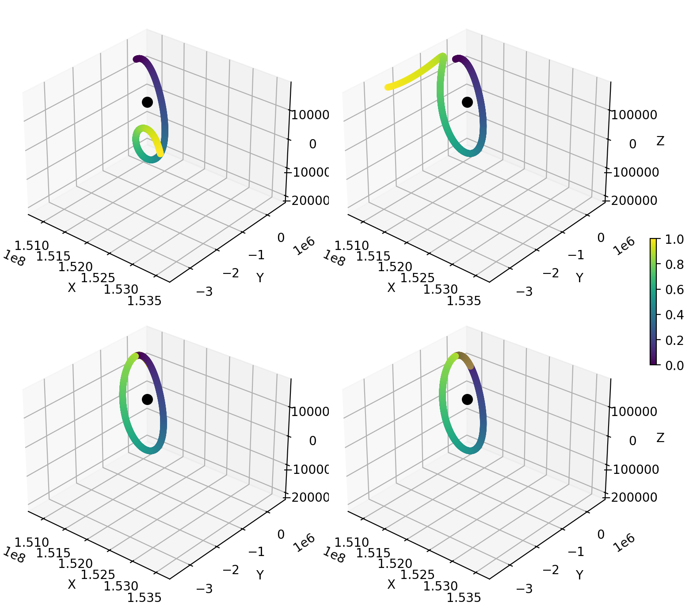
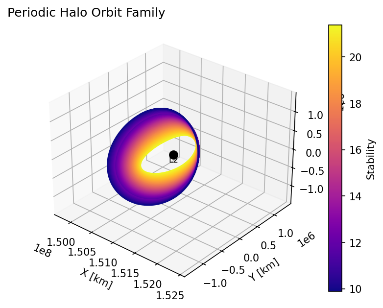
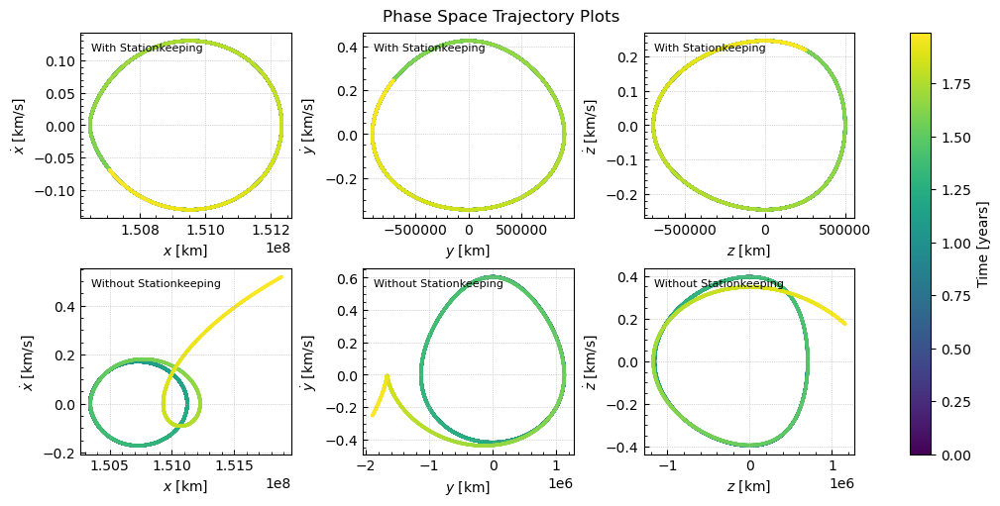

# Periodic Halo Orbit Finder

## Project Overview

The Nancy Grace Roman Space Telescope is NASA's newest space-based observatory similar to Hubble or James Webb. It's a wide field infrared survey telescope built to map large areas of sky quickly rather than study small fields in depth. Primary science objectives include studying the effects of dark energy; searching for more exoplanets via gravitational microlensing and its coronagraph for direct imaging; and probing the universe for primordial black holes. It uses a mirror around the same size as Hubble's but with a field of view more than 100 times larger.

Its parking spot is known as Lagrange point 2 (L2), where the gravitational forces from the Sun and Earth cancel. At L2, the Sun and Earth’s gravity, combined with the spacecraft’s motion around the Sun, keep it lined up with Earth with little fuel use. The location also provides very stable optical performance, a largely unobstructed view of the sky, and reduced heating from the Earth, Sun, and Moon which matters significantly for an infrared telescope. Unlike low Earth orbit, there are no thermal cycles from day/night passes. Roman will remain in a periodic halo orbit during its operational lifespan meaning its orbit leaves the plane of the solar system unlike other orbits designed to attach to unstable Lagrange points.

### Differential Correction

The circular restricted 3 body problem (CR3BP) is a framework for solving for the orbital motion of an object under the influence of two significantly larger gravitational bodies circularly orbiting their center of mass. In this case, the space telescope's position is defined in a rotating coordinate frame so it experience the inertial centrifugal and coriolis forces. Units are defined non-dimensionally in relation to the primary and secondary body's orbit. The x axis spans the separation between the primary and secondary bodies while y is perpendicular to that, along the direction of the circular orbit. The z axis aligns with the common angular momentum direction. Together, they make the state space representation used to simulate the spacecraft.

$$
\mathbf{x} = [x,\ y,\ z,\ \dot{x},\ \dot{y},\ \dot{z}]^T
$$

Equations of motion and the associated potential are given as

$$
\begin{aligned}
\ddot{x} - 2\dot{y} &= U_x \\
\ddot{y} + 2\dot{x} &= U_y \\
\ddot{z} &= U_z
\end{aligned}
\qquad
U(x,y,z) = \frac{1}{2}\left(x^2 + y^2\right) + \frac{1-\mu}{r_1} + \frac{\mu}{r_2}
$$ 

These equations are simulated with the goal of determining initial conditions in position and velocity such that upon crossing the x axis at the bottom of the orbit, $y = 0$, $x$ is at a maximum, and $z$ is at a minimum. This is equivalent to enforcing $\dot{x}(T/2) = \dot{z}(T/2) = 0$ when y reaches 0. Similarly, at the beginning of the orbit, these conditions also hold so the search space of possible initial conditions goes from 6 to 3:


$$
\mathbf{x}_0 = [x_0,\ 0,\ z_0,\ 0,\ \dot{y}_0,\ 0]^T
$$

Define a state transition matrix as follows and integrate it alongside the trajectory using the Jacobian of $f(\mathbf{x},t)$, the dynamics function.

$$
\delta\mathbf{x}(t) = \Phi(t,t_0)\,\delta\mathbf{x}_0
$$

There are three free variables ($`x_0`$, $`z_0`$, $`\dot{y}_0`$) and two constraints ($`\dot{x}_{T/2}`$, $`\dot{z}_{T/2}`$), so we fix one variable and let the other two be adjusted by the differential correction algorithm. I chose $z_0$ as the fixed variable. We can then set up the correction matrix $M$ which essentially maps variations in the initial conditions $x_0$ and $y_0$ to the final state $`\dot{x}_{T/2}`$ and $`\dot{z}_{T/2}`$. 

```math
M = \begin{bmatrix}
\Phi_{41} - \dfrac{\ddot{x}_{T/2}}{\dot{y}_{T/2}}\,\Phi_{21} & \Phi_{45} - \dfrac{\ddot{x}_{T/2}}{\dot{y}_{T/2}}\,\Phi_{25} \\[2ex]
\Phi_{61} - \dfrac{\ddot{z}_{T/2}}{\dot{y}_{T/2}}\,\Phi_{21} & \Phi_{65} - \dfrac{\ddot{z}_{T/2}}{\dot{y}_{T/2}}\,\Phi_{25}
\end{bmatrix}
\qquad
\begin{bmatrix} \delta\dot{x}_{T/2} \\ \delta\dot{z}_{T/2} \end{bmatrix} = M \begin{bmatrix} \delta z_0 \\ \delta\dot{y}_0 \end{bmatrix}
```

The final constraint variables should be driven to 0, so we employ Newton's method with 

$$
\delta \dot{x}_{T/2} = -\dot{x}_{T/2} \qquad \delta \dot{z}_{T/2} = -\dot{z}_{T/2}
$$ 

To obtain a solution closer to these constraints, the periodic orbit, we invert the matrix and repeat the process until the updating variables fall below a small tolerance.

$$
\begin{bmatrix} \delta x_0 \\ \delta\dot{y}_0 \end{bmatrix}
= -M^{-1}
\begin{bmatrix} \dot{x}_{T/2} \\ \dot{z}_{T/2} \end{bmatrix}
$$

The process requires relatively reasonable initial conditions, which is where analytical algorithms for approximate solutions are useful. Being such a highly nonlinear dynamical system, it's extremely sensitive to initial conditions making brute force techniques unfeasible.

### Stability Analysis

Finally, stability of the halo orbits can be evaluated using the eigenvalues of the Monodromy matrix, $\Phi(T, 0)$, simply the state transition matrix for a full period. Eigenvalues, called Floquet multipliers, come in reciprocal pairs and reveal valuable information about the qualities of the orbit. Firstly, eigenvalues in a Hamiltonian system such as this one always come in reciprocal pairs. If the magnitude of the eigenvalue is greater than 1, perturbations in the direction of its eigenvector will grow indicating an instability. Conversely, eigenvalues less than one indicate stable modes of the orbit. Together, a stability index can be defined as follows:

$$
\nu = \frac{1}{2}\left(\lambda_{\max} + \frac{1}{\lambda_{\max}}\right)
$$

For a periodic orbit, there's a pair of eigenvalues both equal to 1 corresponding to the direction along the orbit in state space and the direction adjecent to the orbit but pointing toward other periodic orbits. Two others are complex eigenvalues whose eigenvectors can help solve for orbits which are quasi-periodic meaning they remain bounded along a stable manifold, never repeating exactly but forming a toroid shape in space. This is the true orbit of the Roman Space Telescope but implementation of a quasi-periodic halo orbit solver proved too technically involved for this project.


## Halo Orbit Results

*Figure 1* shows the results of differential correction successfully improving initial conditions that started off providing orbits that would rapidly decay without periodicity. Another approach I took used Differential Evolution, a population based optimization algorithm designed to search a solution space to minimize an objective function J, in this case $`J = \dot{x}_{T/2}^2 + \dot{z}_{T/2}^2`$. It worked fairly well as a point of comparison but is a worse option for finding orbits.

<figure>
    
    <figcaption>Figure 1: Differential correction algorithm converging visually in 4 iterations. Longer term stability is found by repeated correction</figcaption>
</figure>


As seen in *Figure 2*, the stability of the halo is better when less closely orbiting L2. For reference, a lower stability index signifies a more stable orbit. Only orbits with the largest out of plane $z$ components had stabilities sufficient for a space telescope with its limited $\Delta v$ budget.

<figure>
    
    <figcaption>Figure 2: Family or periodic halo orbits found using differential correcion and their associated stabilities.</figcaption>
</figure>

Finally, the following phase space plots (*Figure 3*) show comparisons between orbits propagated to include periodic stationkeeping maneuvers of the spacecraft and those without it. Clearly, some stationkeeping is necessary as numeric instabilities cause even well defined orbital states to diverge after around 18 months.

<figure>
    
    <figcaption>Figure 3: Phase space plots depicting periodicity in the orbit over 1.75 years comparing stationkeeping with no stationkeeping</figcaption>
</figure>

This project did not include perturbations from solar radiation pressure, other body gravitational effects, general relativity, etc. which add inherent complexity to the task of finding and simulating these orbits. A complete engineering analysis would account for these influences as they have significant influence over stationkeeping costs. Additionally, I did not design a trajectory to enter the halo orbit, however optimal insertion maneuvers can be found by determining a stable manifold passing from Earth to L2 which the vehicle can enter to perform a minimal number of trajectory correction maneuvers on its way to its final orbit. 


## References

Deccia, C. M. A., (2017). ANALYSIS OF THE SUN-EARTH LAGRANGIAN ENVIRONMENT FOR THE NEW WORLDS OBSERVER. (Doctoral dissertation, TU Delft).

Folta, D., Pavlak, T., Haapala, A., & Howell, K. (2013). Preliminary design considerations for access and operations in Earth-Moon L1/L2 orbits. Advances in the Astronautical Sciences, 148, 2073-2092.

Guzzetti, D., Spreen, E., Howell, K., & Davis, D. (2017). STATIONKEEPING ANALYSIS FOR SPACECRAFT IN LUNAR NEAR RECTILINEAR HALO ORBITS.

Kolemen, E., Kasdin, N. J., & Gurfil, P., (2007). Quasi-Periodic Orbits of the Restricted Three-Body Problem Made Easy,” AIP Conference Proceedings, vol. 886. AIP, 68–77.

Lujan, D., (2021). Methods to Explore Families of Quasi-Periodic Orbits with
Applications in Astrodynamics. (Doctoral dissertation, University of Colorado Boulder).

Small, J. (2017). Preliminary design considerations for access and operations in Earth-Moon L1/L2 orbits. (Doctoral dissertation, Pennsylvania State University).
